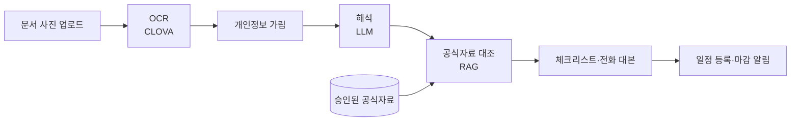

<p align="center">
  
</p>

<h1 align="center">ChungnamOn</h1>

<p align="center">
  받은 행정문서를 모국어로 이해하고, 끝까지 처리하도록<br>
  충남 외국인 주민을 위한 행정문서 해석·공식자료 대조 서비스
</p>

<p align="center">
  <a href="https://chungnam-on.vercel.app/">서비스 바로가기</a> ·
  <a href="https://chungnamon-production.up.railway.app/api/docs/">API 문서</a> ·
  <a href="https://drive.google.com/file/d/1VCz_enqbndPbl2G2hapxSRq28OxBmqVQ/view">시연 영상</a>
</p>

---

## 해결하려는 문제

충남에 사는 외국인 주민은 세금 고지서, 외국인등록 안내문, 건강보험료 고지서 같은 한국어 행정문서를 받습니다.

- **읽기 어렵습니다.** 행정 용어가 많고, 무엇을 언제까지 얼마 내야 하는지 찾기 어렵습니다.
- **믿어도 되는지 알기 어렵습니다.** 사칭 고지서나 피싱 문자, 바뀌기 전의 오래된 안내가 섞여 있어도 공식 정보와 비교할 방법이 없습니다.
- **기한을 놓치기 쉽습니다.** 이해했더라도 준비물, 문의처, 마감일을 따로 챙겨야 합니다.

## 주요 기능

### 1. 사진 한 장으로 읽고 번역하는 행정문서 해석
- 문서를 찍어 올리면 OCR로 글자를 읽고, 문서 종류·금액·기한·납부 방법·문의처를 뽑아냅니다.
- 요약과 전체 번역, 어려운 행정 용어 풀이를 사용자 언어로 보여 줍니다. (베트남어·영어·중국어·우즈베크어·네팔어·태국어·한국어)
- 이름, 외국인등록번호, 여권번호, 주소, 계좌번호, 개인 전화번호 같은 **개인정보는 AI에 보내기 전에 자동으로 가립니다.**

### 2. 공식자료와 대조하는 검증
- 정부24, 시청 등 공식 출처를 수집하고, **관리자가 승인한 자료만** 근거로 씁니다.
- 금액·기한·납부 방법·연락처를 항목별로 대조해 **일치 / 불일치 / 미확인**으로 보여 주고, 근거 출처를 함께 표시합니다.
- "입국일부터 90일 이내"처럼 날짜 대신 규칙으로 적힌 기한도 계산해서 대조합니다.
- 문서의 연락처가 공식 자료와 일치하지 않으면 체크리스트에 연락처 확인 항목을 넣어, 전화하기 전에 기관 누리집에서 공식 번호를 먼저 확인하도록 안내합니다.

### 3. 바로 행동할 수 있게: 체크리스트·전화 대본·마감 알림
- 검증 결과를 근거로 할 일 체크리스트를 만들고, 항목마다 확인됨 / 조건부 / 확인 필요 상태를 붙입니다.
- 담당 기관에 물어볼 내용을 정리한 **전화 대본**을 만들어 줍니다.
- 알림을 켜고 마감일을 일정에 등록하면 **D-7, D-1 푸시 알림**을 보냅니다.
- 공식자료를 근거로 답하는 챗봇으로 추가 질문을 할 수 있습니다.

## 동작 흐름



공식자료는 `수집 → 관리자 승인 → 청크·임베딩 → 사용 중(ACTIVE)` 순서로 반영됩니다. 자세한 내용은 [공식자료 갱신 안내](backend/sources/REFRESH.md)를 참고하세요.

## 기술 스택

| 영역 | 사용 기술 |
|---|---|
| 프론트엔드 | React, Vite (JavaScript·TypeScript 혼용), PWA, Firebase Cloud Messaging |
| 백엔드 | Django, Django REST Framework, JWT 인증(Simple JWT), drf-spectacular(OpenAPI), Firebase Admin(푸시 발송) |
| AI | CLOVA OCR, Anthropic Claude(해석·검증·챗봇), OpenAI 임베딩(공식자료 검색) — 배포 설정 기준 |
| 데이터 | PostgreSQL (로컬 기본값은 SQLite) |
| 배포 | Vercel(프론트), Railway(백엔드·DB) |
| 협업 | GitHub Actions CI, CodeRabbit 코드 리뷰, Notion |

## 팀

그려톤(충청권 멋쟁이사자처럼 연합 해커톤, 2026) 참가 팀입니다.

| 이름 | 역할 |
|---|---|
| 차성진 | 백엔드 (문서 처리 API·파이프라인 연동, 배포·릴리스) |
| 홍영규 | 백엔드 (계정·공식자료 수집·알림) |
| 이우진 | AI (OCR·개인정보 가림·문서 해석) |
| 김보성 | AI (공식자료 검증·챗봇·체크리스트 생성) |
| 정윤재 | 프론트엔드 |

## 실행 방법

### 요구 사항
- Python 3.14
- Node.js 24

### 백엔드

Windows PowerShell 기준입니다.

기존 DB가 있다면 `migrate` 전에 [인증 사용자 모델 전환 주의사항](backend/accounts/README.md#기존-db-전환-차단-사항)을 확인하세요. 기본 User로 `admin` 마이그레이션을 적용한 DB는 별도 전환이 필요합니다.

```powershell
cd backend
python -m venv .venv
.venv\Scripts\Activate.ps1
pip install -r requirements.txt
Copy-Item .env.example .env
python manage.py migrate
python manage.py runserver
```

`.env`의 `DJANGO_SECRET_KEY`는 임의의 긴 문자열로 바꿔 주세요. AI 기능의 `*_MODE` 값은 `.env.example`에서 `dummy`이거나 비어 있고, 비어 있으면 `dummy`로 동작합니다. 그래서 키 없이도 더미 결과로 전체 흐름을 확인할 수 있습니다.

### 프론트엔드

```powershell
cd frontend
npm install
npm run dev
```

브라우저에서 http://localhost:5173 을 열면 됩니다. 개발 서버는 `/api` 요청을 `http://127.0.0.1:8000`으로 프록시합니다.

### 테스트

Swagger UI는 `/api/docs/`, OpenAPI 명세는 `/api/schema/`에서 확인할 수 있습니다.
공통 권한·오류 응답·페이지네이션과 인증 통합 주의사항은 [공통 API 안내](backend/core/README.md)를 참고하세요.

```powershell
cd backend
python manage.py test
```

```powershell
cd frontend
npm run lint
npm run build
```

## 협업 규칙

브랜치, PR, 커밋 규칙은 [CONTRIBUTING.md](CONTRIBUTING.md)를 참고하세요.
